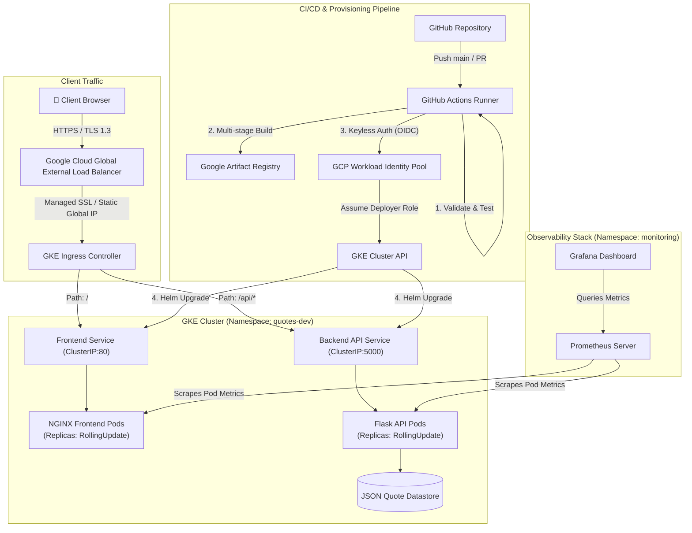

# ✨ Respo Quotes

[](https://github.com/respoamit/Respo-Quotes/actions/workflows/deploy.yml)


> A production-grade, containerized microservices application deployed on Google Kubernetes Engine (GKE), orchestrated with Helm, provisioned with Terraform, and delivered through an automated GitHub Actions GitOps CI/CD pipeline with keyless Workload Identity Federation.

**🌐 Live Application:** [https://amitvarma.online/quotes](https://amitvarma.online/quotes)

---

## 🌟 Overview

**Respo Quotes** is a containerized, cloud-native web application designed to demonstrate enterprise DevOps patterns, infrastructure reliability, and secure multi-tier microservice orchestration on Google Cloud Platform. 

The architecture pairs an event-driven, lightweight frontend (NGINX reverse proxy) with a decoupled Python Flask REST API. Infrastructure provisioning is fully automated through modular Terraform configurations, deployments are managed dynamically using Helm templates, and secrets management adheres to zero-trust principles via GCP Workload Identity Federation.

---

## 🚀 Architectural Highlights

| Capability | Enterprise Implementation |
|---|---|
| **Web Tier** | Lightweight single-page frontend served via hardened NGINX reverse proxy |
| **Application Tier** | Python 3.12 Flask REST API with structured JSON logging |
| **Containerization** | Multi-stage Docker builds optimized for minimal image footprint and attack surface |
| **Container Orchestration** | Google Kubernetes Engine (GKE) running regional managed control planes |
| **Package Management** | Helm v3 parameterized charts managing environments and rollout states |
| **Infrastructure as Code** | Modular Terraform with GCS remote state locking and strict variable typing |
| **Continuous Integration** | Automated syntax linting, unit testing, and Docker build verification on PRs |
| **Continuous Delivery** | GitHub Actions pipeline deploying release tags automatically on `main` push |
| **Keyless Authentication** | OpenID Connect (OIDC) Workload Identity Federation (no service account JSON keys) |
| **Ingress & Networking** | Google Cloud External HTTP(S) Load Balancer with GCP-managed auto-renewing SSL |
| **Workload Observability** | Prometheus scraping cluster metrics with pre-configured Grafana analytics dashboards |
| **Container Registry** | Google Artifact Registry with immutable commit-SHA image tagging |

---

## 🏗️ System Architecture



### Request Flow
1. **DNS & Edge Resolution:** Traffic to `amitvarma.online` resolves to a Google Cloud Global Static Anycast IP.
2. **Ingress Routing:** The Google Cloud Load Balancer terminates TLS and forwards requests to the GKE Ingress controller.
3. **Microservice Routing:**
   - Exact path prefix `/api` is routed to the `respo-quotes-api` ClusterIP service on port `5000`.
   - Root `/` and all asset paths are routed to the `respo-quotes-frontend` ClusterIP service on port `80`.
4. **Resilience & Caching:** The NGINX edge layer handles local static asset caching while proxying live REST payloads from the backend.

---

## 🧰 Technology Stack

### Application Services
* **Frontend:** Vanilla ES6+ JavaScript, CSS3, HTML5, NGINX Alpine
* **Backend:** Python 3.12, Flask, Gunicorn WSGI
* **Data Layer:** Normalized JSON data repository

### Cloud & Infrastructure Engineering
* **Cloud Platform:** Google Cloud Platform (GCP)
* **Compute:** Google Kubernetes Engine (GKE) Standard Cluster
* **Infrastructure as Code (IaC):** HashiCorp Terraform v1.5+
* **Continuous Integration/Continuous Deployment:** GitHub Actions
* **Application Packaging:** Helm v3 Charts
* **Image Registry:** Google Artifact Registry (`asia-south1-docker.pkg.dev`)
* **Security & IAM:** Workload Identity Federation (OIDC token exchange)
* **Ingress & Networking:** Cloud Load Balancing, Google-managed SSL, VPC-native networking

### Telemetry & Monitoring
* **Metrics Ingestion:** Prometheus Operator
* **Visual Dashboards:** Grafana
* **Platform Metrics:** Google Cloud Monitoring & Cloud Logging

---

## ☁️ Production Infrastructure Specifications

```text
Public Ingress Domain:    [https://amitvarma.online/quotes](https://amitvarma.online/quotes)
```

### Ingress & Path Routing Rules

| Match Pattern | Target Service | Container Target Port | Protocol | Purpose |
|---|---|---|---|---|
| `/*` | `respo-quotes-frontend` | `80` | HTTP/1.1 | Static UI assets and NGINX routing |
| `/api/*` | `respo-quotes-api` | `5000` | HTTP/1.1 | REST API JSON endpoints |

---

## 🔄 CI/CD GitOps Pipeline

The deployment automation is codified in `.github/workflows/deploy.yml`.

### Pipeline Execution Phases

```text
+-----------+     +------------+     +--------------------+     +---------------+     +--------------+
| Unit Test | --> | Lint/Check | --> | Build & Tag Images | --> | OIDC Auth GCP | --> | Helm Upgrade |
+-----------+     +------------+     +--------------------+     +---------------+     +--------------+
                                                                                             |
                                                                                             v
                                                                                    +------------------+
                                                                                    | Rollout & Smoke  |
                                                                                    +------------------+
```

1. **Test & Validate:**
   - Executes Pytest unit test suites within isolated Python 3.12 virtualenvs.
   - Validates Helm charts using `helm lint` to prevent chart syntax issues.
   - Runs Terraform configuration checks via `terraform validate`.
2. **Build & Security Check:**
   - Builds optimized, multi-stage Docker images.
   - Tags container artifacts using the immutable short Git commit SHA (`${{ github.sha }}`) to guarantee trace-to-source integrity (no mutable `:latest` tags).
3. **Keyless Authentication (Workload Identity Federation):**
   - GitHub Actions requests an ephemeral OpenID Connect (OIDC) token from GitHub.
   - The token is exchanged with GCP Security Token Service (STS) for short-lived OAuth access tokens.
   - Eliminates persistent service account keys from GitHub repository secrets.
4. **Helm Orchestrated Rollout:**
   - Authenticates directly against the `respo-quotes-gke` cluster endpoint.
   - Executes `helm upgrade --install` injecting the dynamic commit SHA tags.
   - Awaits readiness verification via `kubectl rollout status`.
   - Executes public endpoint smoke tests to confirm live HTTP 200 responses.

---

## 🛡️ Production Hardening & Resilience

### Kubernetes Workload Constraints
Both frontend and API manifests generated by the Helm charts enforce production safety policies:

* **Zero-Downtime Rolling Updates:** Configured with `maxSurge: 25%` and `maxUnavailable: 0` to preserve capacity during deploys.
* **Resource Quotas & Throttling Limits:**
  ```yaml
  resources:
    requests:
      cpu: "100m"
      memory: "128Mi"
    limits:
      cpu: "300m"
      memory: "256Mi"
  ```
* **Readiness & Liveness Probes:**
  - `readinessProbe`: Evaluates HTTP status on `/api/quotes` and `/` before allowing endpoints to receive Load Balancer traffic.
  - `livenessProbe`: Restarts deadlocked or failed containers automatically.
* **Least-Privilege Security Context:**
  - Pods execute as non-root users (`runAsNonRoot: true`).
  - Read-only root filesystems enforced where persistent writes are unnecessary.

---

## 📊 Monitoring & Observability

The infrastructure isolates observability inside a dedicated `monitoring` namespace.

* **Prometheus:** Periodically scrapes container metrics from the Kubernetes API, kubelet endpoints, and the Flask/NGINX pods.
* **Grafana Dashboard:** Visualizes workload health through a dedicated dashboard titled **Respo Quotes - Production**:
  - Live container memory usage versus provisioned limits (OOM risk detection).
  - CPU saturation metrics across pods.
  - Deployment replica health and restart event logs.
  - HTTP status codes (2xx, 4xx, 5xx) and latency percentiles (p50, p95, p99).

---

## 📁 Repository Structure

```text
Respo-Quotes/
├── .github/
│   └── workflows/
│       └── deploy.yml              # End-to-end GitHub Actions CI/CD workflow
├── api/
│   ├── Dockerfile                  # Multi-stage Python build file
│   ├── app.py                      # Flask REST API implementation
│   ├── requirements.txt            # Python dependencies
│   └── test_app.py                 # Pytest automated test cases
├── app/
│   ├── index.html                  # Single-page frontend entrypoint
│   ├── assets/                     # Static styling, client scripts, icons
│   └── data/                       # Normalized quote datasets
├── respo-quotes-chart/             # Helm packaging structure
│   ├── Chart.yaml                  # Chart metadata and versioning
│   ├── values.yaml                 # Configurable deployment values (dev/prod)
│   └── templates/
│       ├── deployment-api.yaml     # Flask API deployment template
│       ├── deployment-ui.yaml      # NGINX Frontend deployment template
│       ├── service-api.yaml        # API internal ClusterIP service
│       ├── service-ui.yaml         # Frontend internal ClusterIP service
│       └── ingress.yaml            # GKE Ingress and routing manifest
├── terraform/                      # Infrastructure as Code
│   ├── main.tf                     # Provider definitions & GCS remote backend
│   ├── variables.tf                # Variable declarations & type constraints
│   ├── outputs.tf                  # Exported outputs (IPs, cluster endpoints)
│   ├── apis.tf                     # GCP API enablement configurations
│   ├── network.tf                  # Custom VPC, subnets, and firewall rules
│   ├── gke.tf                      # GKE cluster & managed node pool resources
│   ├── global-ip.tf                # Static external Anycast IP reservation
│   ├── load-balancer.tf            # Managed certificate & HTTP(S) load balancer
│   └── artifact-registry.tf        # Container image repository setup
├── docker-compose.yml              # Local multi-container development environment
├── nginx.local.conf                # Local reverse-proxy configuration
├── Dockerfile                      # Production Frontend container definition
├── .gitignore
└── README.md
```

---

## 💻 Local Development

You can run the entire microservices stack locally either through Docker Compose (recommended for full environment parity) or directly on your machine.

### Method 1: Multi-Container Setup via Docker Compose (Recommended)

To mirror the production ingress path routing (`/` to Frontend, `/api` to Backend) on your local machine:

1. **Clone the repository:**
   ```bash
   git clone [https://github.com/respoamit/Respo-Quotes.git](https://github.com/respoamit/Respo-Quotes.git)
   cd Respo-Quotes
   ```

2. **Launch the stack:**
   ```bash
   docker compose up --build
   ```

3. **Access the application:**
   - Web UI: `http://localhost`
   - API Endpoint: `http://localhost/api/quotes`

---

### Method 2: Manual Standalone Execution

#### 1. Backend Service (Flask)
```bash
cd api
python3 -m venv venv
source venv/bin/activate
pip install -r requirements.txt
python app.py
```
*API will start listening on `http://127.0.0.1:5000`.*

#### 2. Run API Unit Tests
```bash
cd api
pytest test_app.py -v
```

#### 3. Frontend Service (Static Web Server)
In a separate terminal:
```bash
cd app
python3 -m http.server 8080
```
*Access the local UI at `http://localhost:8080`.*

---

## ☸️ Manual Kubernetes Operations

To inspect or debug the live production cluster:

1. **Authenticate gcloud CLI:**
   ```bash
   gcloud auth login
   gcloud config set project protean-beaker-508610-j3
   ```

2. **Retrieve GKE Cluster Credentials:**
   ```bash
   gcloud container clusters get-credentials respo-quotes-gke --zone asia-south1-a
   ```

3. **Inspect Application Workloads:**
   ```bash
   # Check pod health and restart counts
   kubectl get pods -n quotes-dev -o wide

   # View services and allocated cluster IPs
   kubectl get services -n quotes-dev

   # Inspect ingress status and assigned external IP
   kubectl get ingress -n quotes-dev
   ```

4. **Review Live Helm Releases:**
   ```bash
   helm list -n quotes-dev
   helm status respo-quotes -n quotes-dev
   ```

---

## 🏗️ Managing Infrastructure with Terraform

The Terraform state is secured remotely in a Google Cloud Storage bucket with state locking.

```bash
cd terraform

# Initialize provider plugins and remote GCS backend
terraform init

# Validate configuration syntax
terraform validate

# Review execution plan
terraform plan -out=tfplan

# Apply infrastructure modifications
terraform apply tfplan
```

> **Security Warning:** Never commit `.tfstate` files, service account keys, or `terraform.tfvars` containing unencrypted secrets to source control.

---

## 🔐 Security Standards & Zero-Trust

* **Keyless Identity Management:** Authentication between GitHub Actions and GCP relies entirely on short-lived OIDC exchange, removing the need for long-lived private keys.
* **Principle of Least Privilege:** IAM roles assigned to the Workload Identity Pool restrict permissions exclusively to Artifact Registry pushes and GKE workload deployment.
* **Separation of Concerns:** Application logic (`quotes-dev`) is strictly isolated from monitoring workloads (`monitoring`) across distinct Kubernetes namespaces.
* **Automated Patching:** Managed node pools in GKE leverage Google's automatic node repair and upgrade policies.

---

## 👨‍💻 Author

**Amit Varma**  
*Cloud & DevOps Engineer | Kubernetes, Terraform, CI/CD*

* 🌐 **Live Application:** [amitvarma.online/quotes](https://amitvarma.online/quotes)
* 💻 **GitHub Profile:** [@respoamit](https://github.com/respoamit)

---

<p align="center">
  <sub>Respo Quotes — Engineered with Google Cloud, Kubernetes, and Cloud-Native Best Practices.</sub>
</p>
